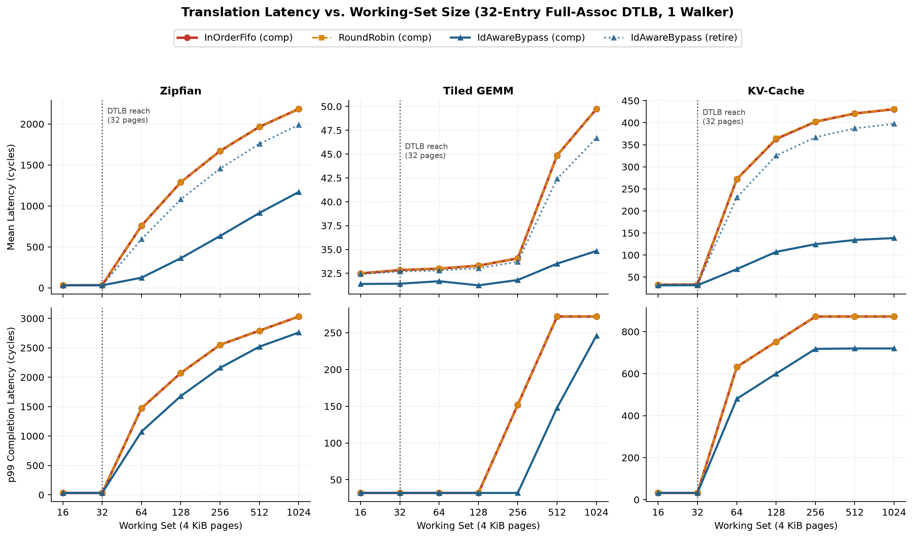
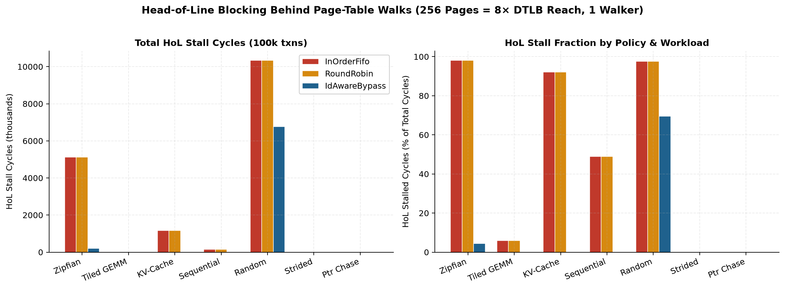
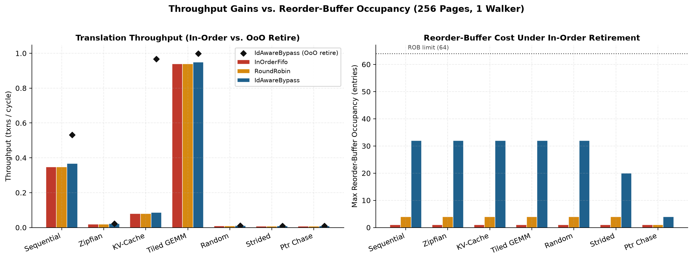
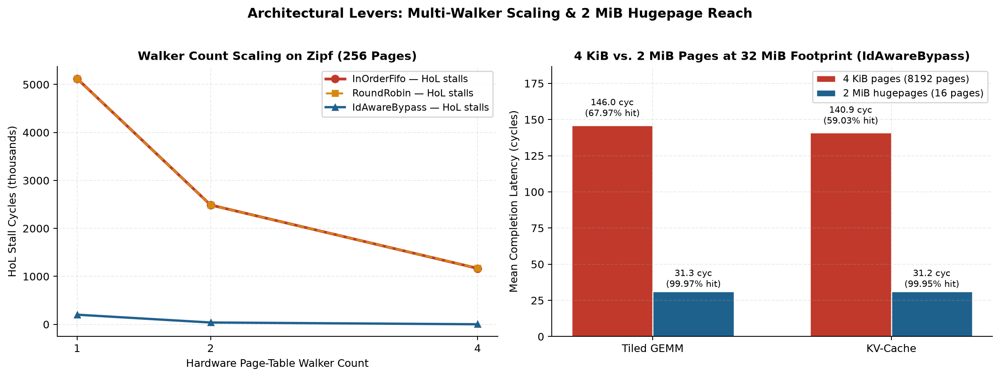

# Translation-Path Performance Model (DTLB / Page-Table Walker / Arbiter)

A cycle-driven **C++17** transaction-level performance model of a virtual-memory address translation pipeline—modeling a configurable **DTLB**, **multi-level hardware page-table walker**, **request arbiter**, **memory latency model**, and **in-order/out-of-order retire stage**—paired with a **Python** validation, sweep, and visualization pipeline.

This module extends the parent repository's 5-stage pipelined ARM LEGv8 RTL ([`../README.md`](../README.md)) by modeling the address-translation path servicing the core's instruction-fetch (`IF`), load (`LDUR`), store (`STUR`), and prefetch request streams.

---

## Architecture

```
  Requesters (0..3)            Arbiter Policy               DTLB (Full / N-way LRU)
  ┌────────────────┐          ┌───────────────┐            ┌───────────────────────┐
  │ 0: IF          │─────────▶│ InOrderFifo   │───────────▶│ 32 entries (default)  │
  │ 1: Load        │─────────▶│ RoundRobin    │  ≤1 req/cy │ hit_cycles = 1        │
  │ 2: Store       │─────────▶│ IdAwareBypass │            │ 4 KiB / 2 MiB pages   │
  │ 3: Prefetch    │─────────▶│               │            └────┬─────────────┬────┘
  └────────────────┘          └───────────────┘                 │ Hit         │ Miss
     ▲                                                          │             ▼
     │ free credit on retire                                    │    ┌───────────────────┐
  ┌────────────────┐                                            │    │ Page-Table Walker │
  │ Retire Stage   │◀───────────────────────────────────────────┘    │ W walkers, L lvls │
  │ In-Order ROB   │◀─────────────── fill + complete ────────────────┤ MSHR + coalescing │
  │ or Out-of-Order│                                                 └────────▲──────────┘
  └────────────────┘                                                          │ L × 40 cyc
                                                                     ┌────────▼──────────┐
                                                                     │   Memory Model    │
                                                                     │ Fixed + opt. BW   │
                                                                     └───────────────────┘
```

- **Arbitration policies:** `InOrderFifo` (single arrival-order FIFO, conservative walker reservation), `RoundRobin` (per-requester fair rotation, shared-walker blocking), and `IdAwareBypass` (non-blocking hit-under-miss with MSHR + ROB).
- **Workloads:** `sequential`, `strided`, `random`, `zipf`, `pointer_chase`, `tiled_gemm` (blocked `C += A × B` across `IF`/`A`/`B`/`C` streams), `kv_cache` (LLM decode streaming + random paged-block indirection), and `trace` (CSV replay).
- **Full design specification:** [docs/design.md](docs/design.md)
- **Analytical & reference validation:** [docs/validation.md](docs/validation.md)

---

## Quickstart (Build, Test, Reproduce All Figures)

### Requirements
- C++17 compiler (`clang++` or `g++`) and CMake $\ge$ 3.16
- GoogleTest (auto-detected via `find_package(GTest)` if installed locally, or fetched automatically via CMake `FetchContent`)
- Python 3 with `numpy`, `pandas`, and `matplotlib` (for sweeps and plots; `ref_tlb.py` and `regress.py` use only the Python standard library)

### Build & Run Full Verification Suite
```bash
cmake -S . -B build -DCMAKE_BUILD_TYPE=Release
cmake --build build -j
ctest --test-dir build --output-on-failure
```
Or via the convenience `Makefile`:
```bash
make test     # builds + runs all 17 CTest checks (GoogleTest + Python LRU ref + Golden regression)
make plot     # runs full 156-point parameter sweep and regenerates all figures in docs/figures/
```

### Run a Single Config
```bash
./build/translation_sim --config configs/baseline_zipf.json
```

---

## Measured Results

All numbers below are measured directly from `./build/translation_sim` and `scripts/run_sweep.py` (`seed = 1`, 4 requesters × 8 outstanding credits = 32 max concurrent transactions, 32-entry fully associative DTLB, 1-cycle hit, 3-level walk, 40-cycle memory latency).

### 1. Policy Comparison Across Workloads (256 Pages = 8× DTLB Reach, 1 Walker, 100k txns, In-Order Retire)

| Workload | Policy | DTLB Hit Rate | Mean Comp. Latency (cyc) | p50 Comp. (cyc) | p99 Comp. (cyc) | Mean Retire Latency (cyc) | Throughput (txns/cyc) | HoL Stall Cycles (% Runtime) | Max ROB Occ. |
|---|---|---:|---:|---:|---:|---:|---:|---:|---:|
| **Zipfian** | `InOrderFifo` | 57.30% | 1,671.3 | 1,712 | 2,552 | 1,671.3 | 0.01914 | 5,123,400 (98.1%) | 1 |
| **Zipfian** | `RoundRobin` | 57.30% | 1,671.3 | 1,712 | 2,552 | 1,671.3 | 0.01914 | 5,123,400 (98.1%) | 4 |
| **Zipfian** | `IdAwareBypass` | 55.46% | **633.9 (-62.1%)** | **5** | 2,160 | **1,455.7 (-12.9%)** | **0.02198 (+14.8%)** | **201,398 (4.4%)** | 32 |
| **KV-Cache** | `InOrderFifo` | 90.35% | 402.5 | 392 | 872 | 402.5 | 0.07951 | 1,157,640 (92.0%) | 1 |
| **KV-Cache** | `RoundRobin` | 90.34% | 402.9 | 392 | 872 | 402.9 | 0.07942 | 1,158,960 (92.0%) | 4 |
| **KV-Cache** | `IdAwareBypass` | 61.78%\* | **124.5 (-69.1%)** | **12** | 718 | **367.1 (-8.8%)** | **0.08709 (+9.5%)** | **0 (0.0%)** | 32 |
| **Tiled GEMM** | `InOrderFifo` | 99.95% | 34.1 | 32 | 152 | 34.1 | 0.93914 | 6,360 (6.0%) | 1 |
| **Tiled GEMM** | `IdAwareBypass` | 99.58% | **31.8 (-6.7%)** | 32 | **32** | 33.7 (-1.1%) | 0.94906 (+1.1%) | **0 (0.0%)** | 32 |
| **Sequential** | `InOrderFifo` | 98.44% | 92.1 | 32 | 512 | 92.1 | 0.34761 | 140,760 (48.9%) | 1 |
| **Sequential** | `IdAwareBypass` | 87.49%\* | **62.0 (-32.6%)** | 32 | 495 | 87.0 (-5.4%) | 0.36756 (+5.7%) | **0 (0.0%)** | 32 |
| **Random** | `InOrderFifo` | 12.51% | 3,391.1 | 3,392 | 3,872 | 3,391.1 | 0.00944 | 10,336,320 (97.5%) | 1 |
| **Random** | `IdAwareBypass` | 12.52% | **2,652.6 (-21.8%)** | 2,880 | 3,719 | 3,118.2 (-8.0%) | 0.01026 (+8.8%) | 6,767,249 (69.4%) | 32 |
| **Strided (4 KiB)** | `InOrderFifo` | 0.00% | 3,871.4 | 3,872 | 3,872 | 3,871.4 | 0.00826 | 0 (0.0%) | 1 |
| **Strided (4 KiB)** | `IdAwareBypass` | 0.00% | 3,771.9 (-2.6%) | 3,840 | 3,840 | 3,839.4 (-0.8%) | 0.00833 (+0.8%) | 0 (0.0%) | 20 |
| **Pointer Chase** | `InOrderFifo` | 0.00% | 484.0 | 484 | 484 | 484.0 | 0.00826 | 0 (0.0%) | 1 |
| **Pointer Chase** | `IdAwareBypass` | 0.00% | 480.0 (-0.8%) | 480 | 480 | 480.0 (-0.8%) | 0.00833 (+0.8%) | 0 (0.0%) | 4 |

*\*Why raw DTLB hit rate is lower under `IdAwareBypass` on `kv_cache` and `sequential`:* When a streaming access crosses into a new page and triggers a 120-cycle walk, subsequent cache-line lookups to that same page enter the DTLB **while the walk is still in flight** rather than stalling behind it. Those lookups register as secondary DTLB misses and **coalesce** onto the active walk in the MSHR at zero extra page-table walk cost, which is why `IdAwareBypass` still delivers higher throughput and 33%–69% lower mean completion latency.

On the 200k-transaction default baseline (`configs/baseline_zipf.json`, `IdAwareBypass`), measured completion latency is **631.97 cycles** (`p50 = 5`, `p95 = 1,919`, `p99 = 2,160`), retirement latency is **1,455.18 cycles** (`p50 = 1,440`, `p99 = 2,279`), throughput is **0.021986 txns/cycle**, HoL stall fraction is **4.13%**, and max ROB occupancy is **32**.

---

### 2. Visual Analysis

#### Latency vs. Working-Set Size


#### Head-of-Line Blocking Across Policies and Workloads


#### Throughput Gains vs. Reorder-Buffer Occupancy


#### Multi-Walker Scaling & 2 MiB Hugepage Reach


---

## Where Hit-Under-Miss Helps — and Where It Does Not

An honest performance model must explain both gains and limits:

1. **Where `IdAwareBypass` wins strongly:**
   - **Mixed hit/miss workloads (`zipf`, `kv_cache`, `tiled_gemm` at 32 MiB):** Cuts mean completion latency by **62.1%–73.8%**, drops median (`p50`) completion latency from hundreds/thousands of cycles down to **5–12 cycles**, and reduces HoL stall cycles by **96.1%–100%**.
   - **Protecting hot streams from miss-heavy neighbors:** On 256-page `kv_cache` (in-order retire), the instruction-fetch (`IF`) stream's mean completion latency drops from **402.5 → 45.6 cycles (-88.7%)** because `IF` hits complete immediately instead of waiting behind paged-KV misses.
2. **Where `IdAwareBypass` is limited or does not help:**
   - **In-order retirement (`retire_in_order = true`) caps throughput gains:** Even when hits complete early, they wait in the ROB behind older walking misses before retiring and freeing requester credits (`ret_mean` improves by 8.8%–13.9%, far less than `comp_mean`), requiring up to **32× higher ROB occupancy** (32 vs. 1 entry).
   - **Zero-hit / walker-saturated regimes (`strided`, `pointer_chase`):** With 0% hit rate, there are no ready hits to bypass behind misses (`hol_stall_cycles == 0` under all policies), so `IdAwareBypass` delivers `< 1%` throughput gain (purely from eliminating the 1-cycle lookup gap between consecutive walks).
   - **High-miss random access (`random`, 87.5% miss rate):** Even with hit-under-miss, the 16-entry MSHR saturates with pending misses and stalls the DTLB port for **69.4%** of cycles; increasing **walker count** (`1 → 4`) or **page size** (`4 KiB → 2 MiB`) is required to relieve walker throughput bottlenecks.
   - **Symmetric workloads (`RoundRobin` vs. `InOrderFifo`):** When all four streams generate balanced load, `RoundRobin` matches `InOrderFifo` closely; its benefit appears specifically under asymmetric/bursty requesters (verified in `Invariants.RoundRobinPreventsStarvation`).
   - **Out-of-order retirement (`retire_in_order = false`) note:** Under a shared total transaction budget on heterogeneous workloads like `kv_cache`, faster high-hit streams (`IF`) recycle credits faster than miss-heavy data streams and account for a larger share of total retired transactions, inflating aggregate throughput (`0.967 txns/cycle`). In-order retirement (`retire_in_order = true`) maintains a balanced 25% per-stream mix for apples-to-apples comparisons.
3. **2 MiB hugepages vs. arbitration alone (32 MiB footprint):**
   - At 32 MiB (`8,192 × 4 KiB` pages vs. `16 × 2 MiB` pages), `IdAwareBypass` alone reduces `tiled_gemm` mean completion latency from **557.0 → 146.0 cycles (-73.8%)**, while switching to **2 MiB hugepages** raises hit rate to **99.97%** and reduces completion latency to **31.3 cycles (-94.4% vs. 4 KiB `InOrderFifo`)** with throughput rising from **0.057 → 0.996 txns/cycle**.

---

## Validation Summary

Running `ctest --test-dir build --output-on-failure` executes **17 automated checks** (~1.8 seconds total):
- **15 GoogleTest unit tests:** JSON/config schema validation, exact analytical latency (`hit_cycles` and `hit_cycles + levels × access_cycles`), LRU set-associativity, 2 MiB hugepage reach, memory bandwidth queueing, single-completion & strict ID-order retirement invariants, `RoundRobin` starvation freedom, determinism, all 7 workloads + commented CSV trace replay, and monotonic working-set / walker-scaling / HoL-reduction trends.
- **`python_lru_reference` (`scripts/ref_tlb.py`):** Independent Python `OrderedDict` LRU simulator matching C++ hit/miss outcomes **bit-for-bit** across 7 pure-trace workloads/geometries and 4 chronological event logs (`RoundRobin` & `IdAwareBypass`).
- **`golden_regression` (`scripts/regress.py`):** Exact deterministic JSON comparison against 5 checked-in baselines in `results/golden/`.

---

## Limitations

See [docs/design.md §8](docs/design.md#8-explicit-limitations-and-non-goals) for the complete list. Key deliberate omissions: no page-walk caches (PDE caching), no L2 STLB hierarchy, no speculative/prefetched walks, no ASIDs or TLB shootdowns, and fixed-latency (optionally BW-capped) abstract memory timing.
